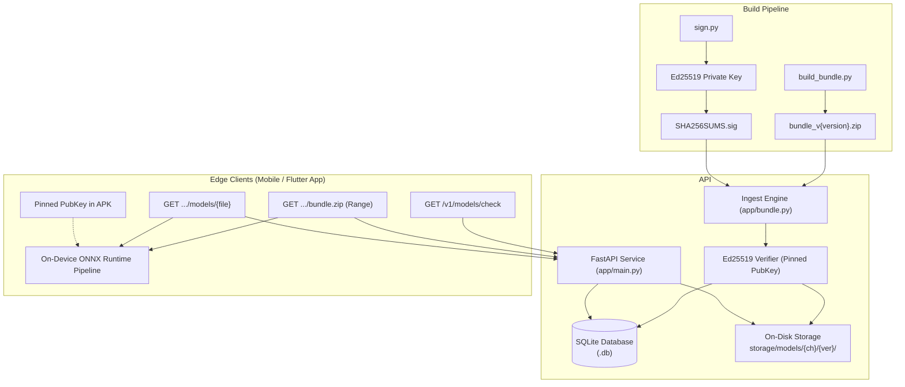
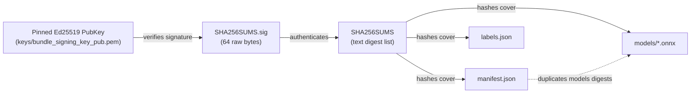
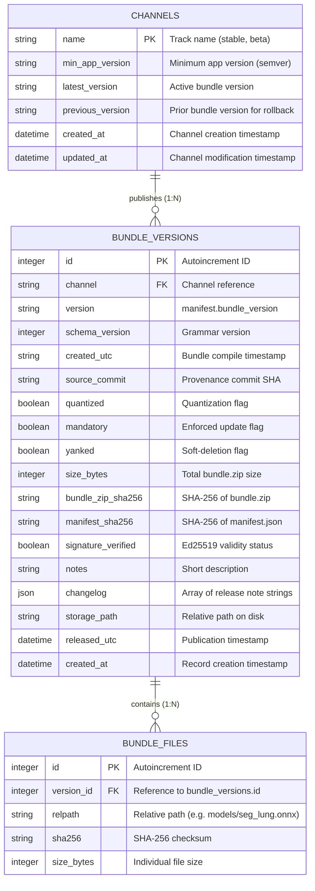
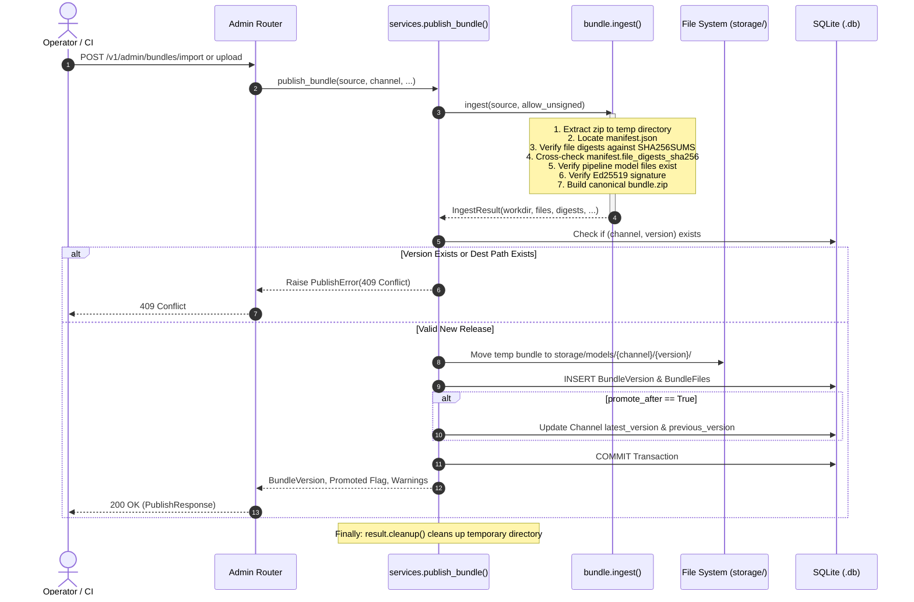
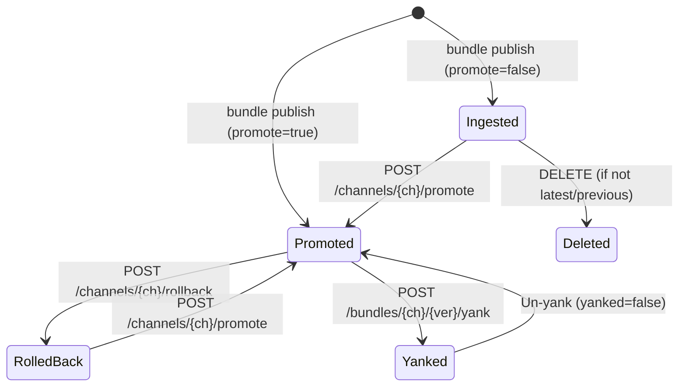
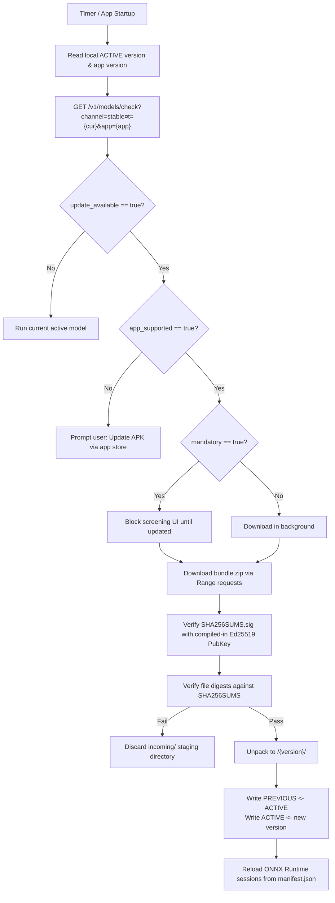

# Technical Documentation & System Specification

Detailed technical documentation and architecture reference, the Over-The-Air (OTA) Model Bundle Distribution Server for the TBScreen diagnostic platform.

---

## Table of Contents

1. [Executive Summary & Background](#1-executive-summary--background)
2. [System Architecture & Design Principles](#2-system-architecture--design-principles)
3. [Model Bundle Specification](#3-model-bundle-specification)
4. [Security & Cryptographic Verification Architecture](#4-security--cryptographic-verification-architecture)
5. [Database Architecture & Persistence](#5-database-architecture--persistence)
6. [Configuration & Environment Reference](#6-configuration--environment-reference)
7. [Comprehensive API Reference](#7-comprehensive-api-reference)
   - [Meta Endpoints](#meta-endpoints)
   - [Catalog & Update Endpoints (Client)](#catalog--update-endpoints-client)
   - [Artifact Distribution Endpoints (Client)](#artifact-distribution-endpoints-client)
   - [Administrative Endpoints (Operator/CI)](#administrative-endpoints-operatorci)
8. [Ingestion & Verification Engine Deep-Dive](#8-ingestion--verification-engine-deep-dive)
9. [Release Channels & Promotion Lifecycle](#9-release-channels--promotion-lifecycle)
10. [Client Integration Protocol & Lifecycle](#10-client-integration-protocol--lifecycle)
11. [Operational Runbook & CLI Workflows](#11-operational-runbook--cli-workflows)
12. [Project Codebase Directory Map](#12-project-codebase-directory-map)

---

## 1. Executive Summary & Background

In clinical tuberculosis (TB) screening in decentralized or low-resource healthcare settings, machine learning models run directly on edge hardware (mobile phones, tablets, or edge gateways) to ensure privacy, zero latency, and operation in offline environments.

The on-device inference pipeline comprises a chain of heterogeneous models:
- **Preprocessing:** Resizing, channel arrangement, normalization (`preprocess.onnx`).
- **Anatomical Segmentation:** FDR-TransUNet for lung field segmentation (`seg_lung.onnx`).
- **Pathology Segmentation:** U-Net for multiclass lesion masks (`seg_lesion.onnx`).
- **Feature Extraction:** Anatomical feature vectors, morphological area ratios, intensity statistics (`features.onnx`).
- **Classification:** Deep CNN classifier (`cnn.onnx`) alongside site-specific Random Forest models (`rf_*.onnx`).
- **Ensemble Fusion:** Final clinical probability aggregation and decision logic (`fuse.onnx`).

### The Core Problem

Retraining or tuning any component (such as updating segmentation weights, calibrating decision thresholds, or switching the active Random Forest model) traditionally required compiling and releasing a new mobile application binary (APK). This introduces unacceptable release friction, store approval delays, and version fragmentation in the field.

### The Solution:

This implements the complete server-side specification defined in `METHODOLOGY.md`. It decouples machine learning model evolution from client application code by providing:
- **Declarative Pipeline Bundles:** The entire execution graph, model parameters, constants, and label mappings are packaged into self-contained, versioned bundles.
- **Asymmetric Signature Gating:** Model bundles are signed at build time with an Ed25519 private key. The server validates signatures at ingest, and client devices verify signatures locally against pinned public keys.
- **Multi-Track Release Channels:** Channels (e.g., `stable`, `beta`) support independent promotion tracks, application version gating, and instant one-click rollbacks.
- **High-Efficiency Transport:** HTTP `Range` requests enable resumable binary downloads over unstable cellular connections, while strong `ETag` and `Cache-Control: immutable` headers eliminate redundant payload transfers.

---

## 2. System Architecture & Design Principles

### Architectural Topology



### Core Design Principles

1. **Bundle Immutability**  
   Once a bundle version is published to a channel, its content is strictly immutable. Bug fixes, re-quantizations, or weight adjustments must be published under a new semantic version (e.g., `YYYY.MM.DD` or `YYYY.MM.N`).
2. **Stateless Serving, Dynamic Indexing**  
   The catalog index (`/v1/models/index.json`) and the update check descriptor (`/v1/models/check`) are synthesized dynamically on every request from SQLite, enabling immediate cache invalidation and instantaneous promotion/rollback propagation.
3. **Defense-in-Depth Verification**  
   The server refuses to ingest bundles with digest mismatches, broken pipeline linkages, or invalid signatures (unless explicitly overridden for local debugging via `allow_unsigned=true`).
4. **Resumability and Bandwidth Optimization**  
   Binary files (`bundle.zip` and individual `.onnx` models) are served via Starlette's `FileResponse`, supporting HTTP `Range` byte-serving. Clients with intermittent connectivity can resume interrupted downloads without restarting from byte zero.

---

## 3. Model Bundle Specification

A bundle represents an autonomous, self-describing diagnostic model release. It contains metadata, integrity proofs, and compiled ONNX execution graphs.

### Bundle Archive Layout

```
bundle_v2026.09.04/
├── manifest.json                         # Pipeline graph, tensor wiring, constants, model metadata
├── labels.json                           # UI strings, lesion categories, RGB palette
├── SHA256SUMS                             # Line-delimited SHA-256 checksums of all bundled files
├── SHA256SUMS.sig                        # 64-byte raw detached Ed25519 signature of SHA256SUMS
└── models/                               # Individual ONNX / ORT model files
    ├── preprocess.onnx                   # NHWC raw uint8 RGB -> normalized tensors
    ├── seg_lung.onnx                     # Lung field segmentation (TransUNet)
    ├── seg_lesion.onnx                   # Lesion segmentation (6-class U-Net)
    ├── features.onnx                     # Mathematical feature engineering (36 features)
    ├── cnn.onnx                          # ResNet-34 image classification
    ├── rf_dataset_gabungan.onnx          # Primary aggregated Random Forest model
    ├── rf_dinkes_sleman.onnx             # Site-specific RF (Sleman District Health)
    ├── rf_balkesmas.onnx                 # Site-specific RF (Balkesmas Clinic)
    ├── rf_respira.onnx                   # Site-specific RF (Respira Hospital)
    ├── rf_sardjito.onnx                  # Site-specific RF (Dr. Sardjito Hospital)
    ├── rf_timika.onnx                    # Site-specific RF (Timika Clinic)
    └── fuse.onnx                         # 0.5 * P_rf + 0.5 * P_cnn >= 0.5 decision fusion
```

### Manifest Structure (`manifest.json`)

The manifest is the authoritative blueprint for the on-device inference executor:

| Top-Level Key | Data Type | Description |
|---|---|---|
| `schema_version` | `integer` | Grammar version for the manifest specification (currently `1`). The mobile client rejects bundles where this exceeds its local parser capability. |
| `bundle_version` | `string` | Release identifier (typically calendar-versioned, e.g. `2026.09.04`). |
| `created_utc` | `string (ISO-8601)` | Timestamp when the bundle was compiled. |
| `source_commit` | `string` | Git SHA or build source provenance reference. |
| `input` | `object` | Input specification: name (`decoded_image`), layout (`NHWC`), channels (`RGB`), and shape (`[1, "H", "W", 3]`). |
| `pipeline` | `array[object]` | Ordered execution chain. Each element maps session inputs from upstream steps and specifies outputs and Execution Provider (EP) preferences. |
| `rf` | `object` | Random Forest model registry: `active` model filename and `available` choices for clinical operators. |
| `outputs` | `object` | Canonical mappings from UI result fields to internal step outputs (`fuse.is_tb`, `fuse.p_fused`, `feat.lung_mask`, etc.). |
| `render` | `object` | Rendering labels (`TB`, `NON TB`), lesion names (`fibrotik`, `konsolidasi`, etc.), and lesion RGB overlay colors. |
| `baked_constants` | `object` | Informational mirror of threshold constants compiled into the computational graphs. |
| `feature_order` | `array[string]` | Exact 36-feature name sequence produced by `features.onnx` and expected by RF models. |
| `models` | `object` | Detailed metadata for each model (shapes, activations, class indices). |
| `file_digests_sha256` | `object` | POSIX relative paths mapped to expected SHA-256 hashes for selective/delta downloads. |

---

## 4. Security & Cryptographic Verification Architecture

The trust architecture is anchored in asymmetric cryptography and content-addressable hashing.

### The Integrity Chain



### Verification Pipeline Sequence

During bundle publication via `POST /v1/admin/bundles/import` or `POST /v1/admin/bundles/upload`, `app/bundle.py` executes a mandatory 5-stage verification:

1. **Integrity File Presence & Parsing:**  
   Verifies that `manifest.json` and `SHA256SUMS` exist. Parses `SHA256SUMS` into normalized POSIX relative paths and 64-character lowercase hexadecimal digests.
2. **Byte-Level Digest Verification:**  
   Every entry listed in `SHA256SUMS` (excluding `SHA256SUMS` itself and `SHA256SUMS.sig`) is hashed from disk via streaming SHA-256. Any missing file or hash mismatch triggers an immediate HTTP `422 Unprocessable Entity`.
3. **Manifest Mirror Cross-Check:**  
   `manifest.file_digests_sha256` is checked against `SHA256SUMS`. Every entry in the manifest must exist in `SHA256SUMS` with identical digest values.
4. **Computational Graph Referential Integrity:**  
   Every step in `manifest.pipeline[]` referencing a static model file (excluding dynamic runtime alias `@rf_active`) is verified to exist on disk under `models/`.
5. **Ed25519 Digital Signature Verification:**  
   The detached signature in `SHA256SUMS.sig` is checked against the raw byte sequence of `SHA256SUMS` using the pinned Ed25519 public key.
   - If valid: `signature_verified = True`.
   - If invalid/missing and `DEMO_API_REQUIRE_SIGNATURE=True` (and `allow_unsigned=False`): Rejected with HTTP `422`.
   - If invalid/missing and `allow_unsigned=True`: Accepted with `signature_verified = False` and an explicit warning.

### Path Traversal Defense

User-supplied filenames in `/v1/models/{channel}/{version}/models/{file:path}` are sanitized via `app/storage.py`'s `safe_member_path()`:
- Rejects paths containing `..` or empty segments.
- Rejects absolute paths and Windows drive letters or Alternate Data Streams (`:`).
- Confirms resolved absolute path resides strictly within the parent bundle directory.

---

## 5. Database Architecture & Persistence

The catalog database is managed through SQLAlchemy 2.0 with a SQLite backend.

### Entity-Relationship Diagram



### Table Specifications

#### 1. `channels`
Represents an independent distribution track.
- `name` (`VARCHAR(64)`, PK): Unique channel name (e.g., `stable`, `beta`).
- `min_app_version` (`VARCHAR(32)`): Semver version floor. Applications below this version will receive `app_supported: false` in update checks.
- `latest_version` (`VARCHAR(64)`, Nullable): Currently promoted active bundle version.
- `previous_version` (`VARCHAR(64)`, Nullable): Immediately preceding version, used for atomic one-step rollback.

#### 2. `bundle_versions`
Stores verified bundle metadata.
- `uq_channel_version`: Unique constraint on `(channel, version)` ensuring release immutability.
- `yanked` (`BOOLEAN`): When `True`, the version is hidden from client `/index.json` and `/check` endpoints without deleting files from disk.
- `changelog` (`JSON`): List of change descriptions surfaced to mobile client UI.
- Foreign Key to `channels.name` with `ON DELETE CASCADE`.

#### 3. `bundle_files`
Stores individual model and metadata digests, enabling per-file lazy retrieval and client-side pre-validation.
- `uq_version_relpath`: Unique constraint on `(version_id, relpath)`.
- Foreign Key to `bundle_versions.id` with `ON DELETE CASCADE`.

---

## 6. Configuration & Environment Reference

Configuration is managed via `app/config.py` using `pydantic-settings`. All parameters can be configured through environment variables prefixed with `DEMO_API_` or defined in a local `.env` file.

| Environment Variable | Type | Default Value | Description |
|---|---|---|---|
| `DEMO_API_DATABASE_URL` | `string` | `sqlite:///./demo_api.db` | SQLAlchemy connection string. |
| `DEMO_API_STORAGE_DIR` | `Path` | `storage` | Root directory where published model files are stored. |
| `DEMO_API_PUBLIC_BASE_URL` | `string` | `http://localhost:8000` | Base URL used to construct absolute URLs in API responses. Configurable via `.env` to a custom domain or reverse proxy. |
| `DEMO_API_PINNED_PUBKEY_PATH` | `Path` | `keys/bundle_signing_key_pub.pem` | Path to the Ed25519 public key file used to verify bundle signatures. |
| `DEMO_API_REQUIRE_SIGNATURE` | `boolean` | `true` | If `true`, bundles without a valid signature are rejected (`422`). If `false`, bundles are accepted with `signature_verified = false`. |
| `DEMO_API_AUTO_PROMOTE_ON_PUBLISH`| `boolean` | `true` | If `true`, publishing a bundle automatically sets it as the active `latest_version` for the channel. |
| `DEMO_API_INDEX_CACHE_SECONDS` | `integer` | `60` | HTTP `Cache-Control: max-age` seconds applied to dynamic `/index.json` and `/check` endpoints. |
| `DEMO_API_SEED_CHANNELS` | `JSON list` | `["stable", "beta"]` | Channels automatically created in SQLite upon initial application startup. |

---

## 7. Comprehensive API Reference

All requests and responses use standard JSON encoding unless delivering binary artifacts.

### Meta Endpoints

#### `GET /`
Returns service identifier, API version, and navigation links.
- **Response `200 OK`:**
  ```json
  {
    "service": "demo_api",
    "version": "0.1.0",
    "docs": "/docs",
    "index": "/v1/models/index.json"
  }
  ```

#### `GET /healthz`
Liveness probe for load balancers and container orchestrators.
- **Response `200 OK`:**
  ```json
  {
    "status": "ok"
  }
  ```

---

### Catalog & Update Endpoints (Client)

#### `GET /v1/models/index.json`
Returns the complete release catalog across all channels and non-yanked versions.

- **Headers Returned:**
  - `ETag`: SHA-256 checksum of canonical JSON response body.
  - `Cache-Control`: `public, max-age={DEMO_API_INDEX_CACHE_SECONDS}`.
- **Conditional Requests:** If the request includes `If-None-Match` matching the current ETag, the server returns `304 Not Modified`.
- **Response `200 OK` Schema:**
  ```json
  {
    "channels": {
      "stable": {
        "latest": "2026.09.04",
        "min_app_version": "0.0.0",
        "versions": {
          "2026.09.04": {
            "schema_version": 1,
            "released_utc": "2026-09-17T08:45:35.191051Z",
            "size_bytes": 196853241,
            "quantized": true,
            "mandatory": false,
            "signature_verified": true,
            "bundle_zip": "http://localhost:8000/v1/models/stable/2026.09.04/bundle.zip",
            "bundle_zip_sha256": "3fa9...41c2",
            "manifest_url": "http://localhost:8000/v1/models/stable/2026.09.04/manifest.json",
            "labels_url": "http://localhost:8000/v1/models/stable/2026.09.04/labels.json",
            "sha256sums_url": "http://localhost:8000/v1/models/stable/2026.09.04/SHA256SUMS",
            "signature_url": "http://localhost:8000/v1/models/stable/2026.09.04/SHA256SUMS.sig",
            "files_base": "http://localhost:8000/v1/models/stable/2026.09.04/models/",
            "notes": "seeded quantized bundle",
            "changelog": [
              "Initial field bundle",
              "seg_lung fp16, cnn / seg_lesion int8",
              "RF: dataset_gabungan active"
            ]
          }
        }
      }
    }
  }
  ```

---

#### `GET /v1/models/check`
Single-round-trip update descriptor tailored to the client's current installation state.

- **Query Parameters:**
  - `channel` (`string`, default: `"stable"`): Distribution track to check.
  - `current` (`string`, optional): The client's currently active bundle version (e.g., `"2026.08.30"`).
  - `app` (`string`, optional): Client application version (e.g., `"1.4.2"`).
  - `abi` (`string`, optional): Client device architecture ABI (e.g., `"arm64-v8a"`), accepted for client parity.

- **Response `200 OK` (Update Available):**
  ```json
  {
    "update_available": true,
    "channel": "stable",
    "latest": "2026.09.04",
    "current": "2026.08.30",
    "mandatory": false,
    "min_app_version": "1.0.0",
    "app_supported": true,
    "schema_version": 1,
    "size_bytes": 196853241,
    "quantized": true,
    "signature_verified": true,
    "bundle_zip": "http://localhost:8000/v1/models/stable/2026.09.04/bundle.zip",
    "bundle_zip_sha256": "3fa9...41c2",
    "manifest_url": "http://localhost:8000/v1/models/stable/2026.09.04/manifest.json",
    "labels_url": "http://localhost:8000/v1/models/stable/2026.09.04/labels.json",
    "sha256sums_url": "http://localhost:8000/v1/models/stable/2026.09.04/SHA256SUMS",
    "signature_url": "http://localhost:8000/v1/models/stable/2026.09.04/SHA256SUMS.sig",
    "files_base": "http://localhost:8000/v1/models/stable/2026.09.04/models/",
    "release_notes": "seeded quantized bundle",
    "changelog": [
      "Initial field bundle",
      "seg_lung fp16, cnn / seg_lesion int8",
      "RF: dataset_gabungan active"
    ]
  }
  ```

- **Response `200 OK` (Up to Date):**
  ```json
  {
    "update_available": false,
    "channel": "stable",
    "latest": "2026.09.04",
    "current": "2026.09.04",
    "mandatory": false,
    "min_app_version": "1.0.0",
    "app_supported": true
  }
  ```

- **Response `404 Not Found`:** Returned if the requested channel does not exist.

---

### Artifact Distribution Endpoints (Client)

All artifact endpoints support `GET` and `HEAD` methods. Responses include:
```http
Cache-Control: public, max-age=31536000, immutable
```

| Route | Content-Type | Range Support | Description |
|---|---|---|---|
| `/v1/models/{channel}/{version}/manifest.json` | `application/json` | Yes | Complete pipeline definition and wiring. |
| `/v1/models/{channel}/{version}/labels.json` | `application/json` | Yes | Decision and lesion class definitions. |
| `/v1/models/{channel}/{version}/SHA256SUMS` | `text/plain; charset=utf-8`| Yes | Checksums for all bundled artifacts. |
| `/v1/models/{channel}/{version}/SHA256SUMS.sig` | `application/octet-stream` | Yes | Detached 64-byte Ed25519 signature. |
| `/v1/models/{channel}/{version}/bundle.zip` | `application/zip` | **Yes (Resumable)** | Canonical all-in-one archive of the bundle. |
| `/v1/models/{channel}/{version}/models/{file:path}` | `application/octet-stream` | **Yes (Resumable)** | Individual ONNX model file for lazy/delta sync. |

> [!NOTE]
> Starlette's `FileResponse` automatically handles standard `Range: bytes=START-END` request headers, returning `206 Partial Content` with `Content-Range: bytes START-END/TOTAL`.

---

### Administrative Endpoints (Operator/CI)

#### Channel Management

##### `POST /v1/admin/channels`
Creates a new release track.
- **Request Body:**
  ```json
  {
    "name": "internal-qa",
    "min_app_version": "1.2.0"
  }
  ```
- **Response `201 Created`:** Channel object.
- **Response `409 Conflict`:** If channel already exists.

##### `GET /v1/admin/channels`
Lists all registered channels.
- **Response `200 OK`:** Array of channel objects.

##### `PATCH /v1/admin/channels/{channel}`
Updates channel properties (such as updating the minimum application version requirement).
- **Request Body:**
  ```json
  {
    "min_app_version": "1.3.0"
  }
  ```
- **Response `200 OK`:** Updated channel object.

##### `POST /v1/admin/channels/{channel}/promote`
Manually points a channel's `latest_version` to a previously ingested bundle.
- **Request Body:**
  ```json
  {
    "version": "2026.09.04",
    "mandatory": true
  }
  ```
- **Response `200 OK`:** Updated channel object with `latest_version` set and previous latest assigned to `previous_version`.

##### `POST /v1/admin/channels/{channel}/rollback`
Performs an atomic single-step rollback (`latest_version` swapped with `previous_version`).
- **Response `200 OK`:** Updated channel object.
- **Response `409 Conflict`:** If channel has no `previous_version` recorded.

---

#### Bundle Publication & Lifecycle

##### `POST /v1/admin/bundles/import`
Ingests a bundle from a filesystem path accessible to the server (e.g. built by a CI runner or seed script).
- **Request Body:**
  ```json
  {
    "source_path": "dist/bundle_v1_quant.zip",
    "channel": "beta",
    "quantized": true,
    "notes": "Weekly QA build",
    "changelog": ["Updated lung segmentation weights", "Fixed calibration drift"],
    "mandatory": false,
    "promote": true,
    "allow_unsigned": false
  }
  ```
- **Response `200 OK`:**
  ```json
  {
    "bundle": {
      "channel": "beta",
      "version": "2026.09.04",
      "schema_version": 1,
      "created_utc": "2026-09-03T17:35:21+00:00",
      "source_commit": "main@a1b2c3d",
      "quantized": true,
      "mandatory": false,
      "yanked": false,
      "size_bytes": 196853241,
      "bundle_zip_sha256": "3fa9...41c2",
      "manifest_sha256": "188c...9ed5",
      "signature_verified": true,
      "notes": "Weekly QA build",
      "changelog": [
        "Updated lung segmentation weights",
        "Fixed calibration drift"
      ],
      "released_utc": "2026-10-09T12:00:00Z"
    },
    "promoted": true,
    "warnings": []
  }
  ```

##### `POST /v1/admin/bundles/upload`
Multipart form upload of a `bundle_v*.zip` file.
- **Form Fields:**
  - `file`: Binary zip stream (`UploadFile`).
  - `channel`: Channel name (`string`).
  - `quantized`: Boolean (`true`/`false`).
  - `notes`: String summary.
  - `changelog`: Multi-value string entries.
  - `mandatory`: Boolean.
  - `promote`: Boolean (default: `true`).
  - `allow_unsigned`: Boolean (default: `false`).
- **Response `200 OK`:** `PublishResponse` schema.

##### `GET /v1/admin/bundles`
Returns flat list of all bundles across all channels.

##### `GET /v1/admin/bundles/{channel}/{version}`
Returns detailed metadata for a specific bundle, including its `files[]` list and individual digests.

##### `POST /v1/admin/bundles/{channel}/{version}/yank`
Sets the bundle's `yanked` flag.
- **Request Body:**
  ```json
  {
    "yanked": true
  }
  ```
- Yanked bundles are immediately omitted from `/v1/models/index.json` and `/v1/models/check`.

##### `DELETE /v1/admin/bundles/{channel}/{version}`
Permanently deletes bundle records and on-disk files.
- **Response `204 No Content`:** On success.
- **Response `409 Conflict`:** If the bundle is currently pointed to by `latest_version` or `previous_version`.

---

## 8. Ingestion & Verification Engine Deep-Dive

The publication flow is implemented across `app/services.py` and `app/bundle.py`.



### Fault Tolerance & Transaction Safety

If an error occurs at any point during file ingestion or database insertion:
1. The database transaction is rolled back via `db.rollback()`.
2. Any newly staged destination directory in `storage/models/{channel}/{version}/` is cleaned up via `shutil.rmtree()`. Pre-existing directories are left untouched.
3. The temporary working directory created during ingest is deleted in the `finally` block via `result.cleanup()`.

---

## 9. Release Channels & Promotion Lifecycle

Release channels decouple active production fleets from active testing:



### Channel State Transitions

1. **Staged Publication:**  
   A bundle can be ingested into a channel with `promote: false`. It is written to storage and database, visible in admin tools, but not served to client `/check` queries as latest.
2. **Promotion:**  
   When promoted:
   - Current `latest_version` becomes `previous_version`.
   - The promoted version becomes `latest_version`.
3. **Atomic Single-Step Rollback:**  
   Calling `POST /v1/admin/channels/{channel}/rollback`:
   - `latest_version` and `previous_version` are swapped.
   - Mobile clients polling `/check` are immediately directed to the prior version.
4. **Release Yanking:**  
   If a flaw is discovered in a release that cannot be rolled back immediately, setting `yanked: true` ensures client checks ignore the version while preserving disk state for diagnostic analysis.

---

## 10. Client Integration Protocol & Lifecycle

This section describes the client-side lifecycle implemented by consumer applications (such as the Flutter mobile app).

### Client State Directory

On client storage (e.g. Android app internal files directory):

```
<app-storage>/models/
├── ACTIVE                    # Text file containing the active bundle version string
├── PREVIOUS                  # Text file containing previous version string (for rollback)
├── incoming/                 # Staging area for *.part resumable downloads
├── 2026.09.04/               # Fully validated, unpacked active bundle
└── 2026.08.30/               # Previous good bundle retained for local rollback
```

### Client Update Loop



### Offline Sideloading

In clinics without internet access:
1. Operator downloads `bundle_vYYYY.MM.DD.zip` from an internet-connected workstation.
2. Operator transfers the zip file to the mobile device via USB OTG drive or SD card.
3. Mobile app's "Sideload Model Bundle" feature imports the zip, executes the same signature and digest verification against its compiled-in public key, and activates the bundle identically.

---

## 11. Operational Runbook & CLI Workflows

### Setup & Startup

```powershell
# From the project root directory:
python -m venv .venv
.venv\Scripts\Activate.ps1

# Install project dependencies
pip install -r requirements.txt

# Start FastAPI development server
uvicorn app.main:app --host 0.0.0.0 --port 8000 --reload
```

### Seeding Bundles

The project includes `scripts/seed.py` to populate the local database and storage directly from artifacts built in local pipeline:

```powershell
# Seed quantized bundle to stable channel (promoted)
python -m scripts.seed

# Seed quantized bundle to beta and unquantized bundle to stable
python -m scripts.seed --with-unquant
```

### Common Operator Commands (cURL / PowerShell)

#### 1. Ingest Bundle via Local Path
```powershell
curl.exe -X POST "http://localhost:8000/v1/admin/bundles/import" `
  -H "Content-Type: application/json" `
  -d '{
    "source_path": "dist/bundle_v1_quant.zip",
    "channel": "beta",
    "quantized": true,
    "promote": false,
    "allow_unsigned": true,
    "changelog": ["First beta drop", "Retrained lung segmentation"]
  }'
```

#### 2. Promote Version to Active
```powershell
curl.exe -X POST "http://localhost:8000/v1/admin/channels/beta/promote" `
  -H "Content-Type: application/json" `
  -d '{"version": "2026.09.04", "mandatory": false}'
```

#### 3. Client Update Query
```powershell
curl.exe "http://localhost:8000/v1/models/check?channel=beta&current=2026.01.01&app=1.0.0"
```

#### 4. Resumable Download with HTTP Range
```powershell
# Fetch first 1024 bytes (Range request)
curl.exe -i -r 0-1023 -o part.bin `
  "http://localhost:8000/v1/models/beta/2026.09.04/bundle.zip"
```

#### 5. Conditional GET with ETag
```powershell
# Initial fetch to obtain ETag header
curl.exe -i "http://localhost:8000/v1/models/index.json"

# Conditional request returning 304 Not Modified
curl.exe -i -H 'If-None-Match: "c3a2f960..."' "http://localhost:8000/v1/models/index.json"
```

#### 6. Emergency Rollback
```powershell
curl.exe -X POST "http://localhost:8000/v1/admin/channels/beta/rollback"
```

---

## 12. Project Codebase Directory Map

```
demo_api/
│
├── .env.example                     # Environment template with commented defaults
├── .gitignore                       # Git exclusion rules (storage/, *.db, .venv/)
├── demo_api.db                      # Local SQLite catalog database (generated at runtime)
├── requirements.txt                 # Pinned dependencies (FastAPI, SQLAlchemy, Cryptography, etc.)
├── README.md                        # High-level project overview & quickstart
├── DOCS.md                          # Comprehensive technical documentation & specification (this file)
│
├── .http/
│   └── f.http                       # VS Code REST client test request suite
│
├── keys/
│   └── bundle_signing_key_pub.pem   # Pinned Ed25519 public key (PEM format)
│
├── scripts/
│   ├── __init__.py
│   └── seed.py                      # Automated catalog seeder from pipeline build artifacts
│
├── storage/                         # On-disk bundle storage root (created at runtime)
│   └── models/
│       ├── beta/
│       │   └── 2026.09.04/          # Stored bundle files (manifest, sums, models, bundle.zip)
│       └── stable/
│           └── 2026.09.04/
│
└── app/
    ├── __init__.py                  # Application metadata and version (__version__ = "0.1.0")
    ├── main.py                      # FastAPI app entry point, lifespan, exception handlers
    ├── config.py                    # pydantic-settings Settings model & path resolvers
    ├── database.py                  # SQLAlchemy engine, session maker, lightweight schema migrator
    ├── models.py                    # Declarative ORM models (Channel, BundleVersion, BundleFile)
    ├── schemas.py                   # Pydantic request and response schemas
    ├── versioning.py                # Semantic version parsing, comparison, and app gating
    ├── storage.py                   # Storage root resolution and path traversal sanitization
    ├── bundle.py                    # Ingest pipeline, zip extraction, digest & Ed25519 verification
    ├── http_utils.py                # Canonical JSON serializer and ETag response generator
    ├── services.py                  # Catalog query builders, promotion, rollback, publication service
    │
    └── routers/
        ├── __init__.py
        ├── catalog.py               # Public endpoints: /v1/models/index.json, /v1/models/check
        ├── artifacts.py             # Binary endpoints: manifest, sums, bundle.zip, individual models
        └── admin.py                 # Admin endpoints: channel CRUD, promote/rollback, bundle upload
```

